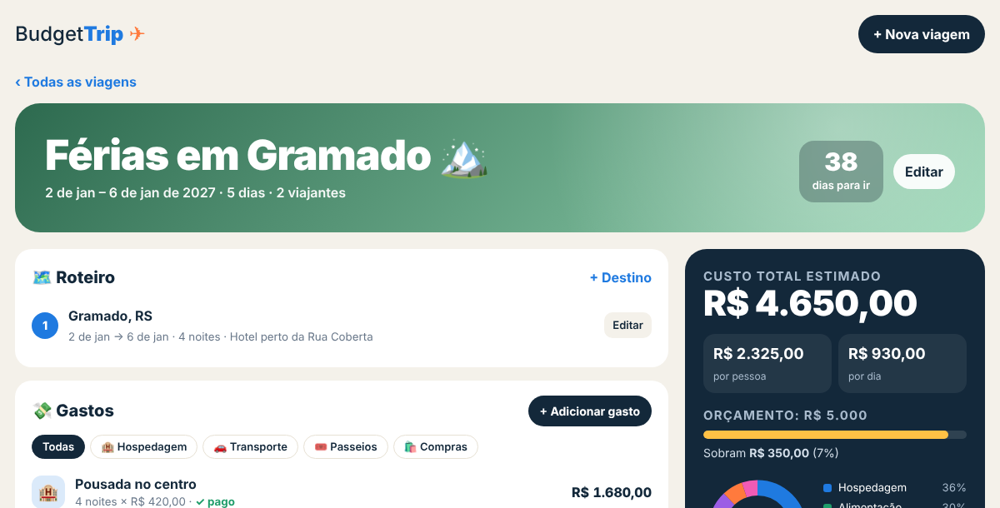

# BudgetTrip — Planejador de viagens

Planejador de viagens que organiza destinos, datas e hospedagem e estima o custo total com base nos valores informados.

🔗 **[Ver o site no ar](https://iamviniciuslima05.github.io/PROJETO-BudgetTrip/)**



## Funcionalidades

- Várias **viagens** com datas, viajantes e orçamento
- **Roteiro** com cidades e datas de chegada e saída
- **Hospedagem** por noite × número de noites
- Gastos de **transporte, passeios, compras** e outros, com valor por pessoa
- **Alimentação** estimada por pessoa por dia
- **Custo total, por pessoa e por dia**
- Comparação com o **orçamento** e gráfico por categoria
- Quanto **já foi pago** e quanto falta
- Contagem de **dias para a viagem**

## Tecnologias

HTML5 · CSS3 · JavaScript · SVG · localStorage

## Estrutura

```
index.html
css/style.css
js/script.js
```

## Como rodar

Não precisa instalar nada: baixe o projeto e abra o `index.html` no navegador, ou acesse a versão publicada acima.

---
Feito por **Vinicius Lima** · [Portfólio](https://viniciuslimadev.netlify.app) · [LinkedIn](https://www.linkedin.com/in/viniciuslima25/)
